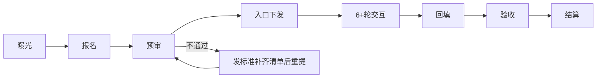
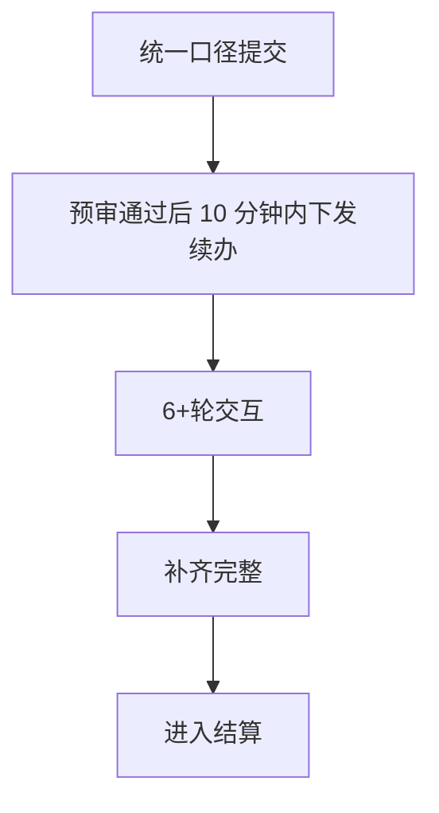
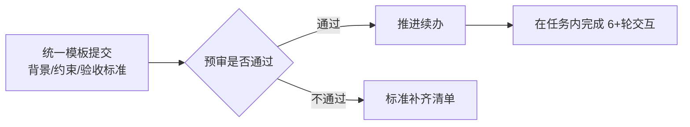
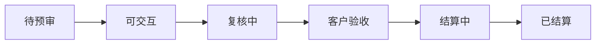

# 第三期专家招募工具包（对外）

> 版本：2026-07-24  
> 使用边界：第三期统一对外口径（不得新增价格或付款变体）

## 0. 一页对外说明（可直接发给渠道/群）

- 招募主题：第三期垂域高难度题目  
- 统一结算：`200 元 / 题`  
- 结算触发：客户验收通过 + 结果回流完成  
- 结算时效：`3` 个工作日  
- 交互门槛：`6+` 轮  
- 关键识别：预审通过 ≠ 验收通过  

## 1. 对外流程（可直接复用）

## 2. 外部话术（建议直接复制）

### 2.1 首屏招募说明

### 2.2 首条私聊模板

### 2.3 固定回复（禁止改写）

| 问题 | 标准回复 |
|---|---|
| 预审和验收一样吗？ | 预审只决定可不可以进交互，不等于验收通过。 |
| 能先拿款吗？ | 不行。结算必须在验收通过后且按流程走 3 个工作日。 |
| 6+轮可以跳吗？ | 不能。必须保留 6+ 轮交互与记录。 |
| 可否替提交人代交互？ | 不可，提交与交互以本人身份执行。 |

## 3. 外部最小采集项

1. 姓名 / 豆包 UID  
2. 题目背景与目标  
3. 时间约束、权限边界  
4. 验收标准（成功条件 + 失败条件）  
5. 是否含敏感依赖  

**禁采信息**：身份证、银行卡、验证码、账号口令  

## 4. 外部状态看板文案

- 待预审：待初筛和资料完整性确认  
- 可交互：续办入口已下发  
- 复核中：交互与结果待对齐  
- 已结算：付款完成，流程关闭

## 5. 发布前检查（对外素材口径）

- [ ] 是否明确标注“预审≠验收”  
- [ ] 是否写明 200 元 / 题  
- [ ] 是否写明 3 个工作日结算  
- [ ] 是否明确不承诺额外补贴/加急  
- [ ] 是否提供失败重提路径（补齐清单）
