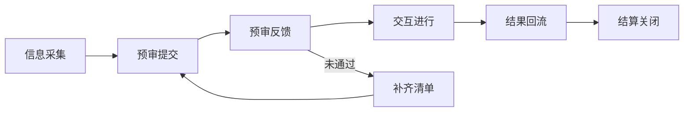
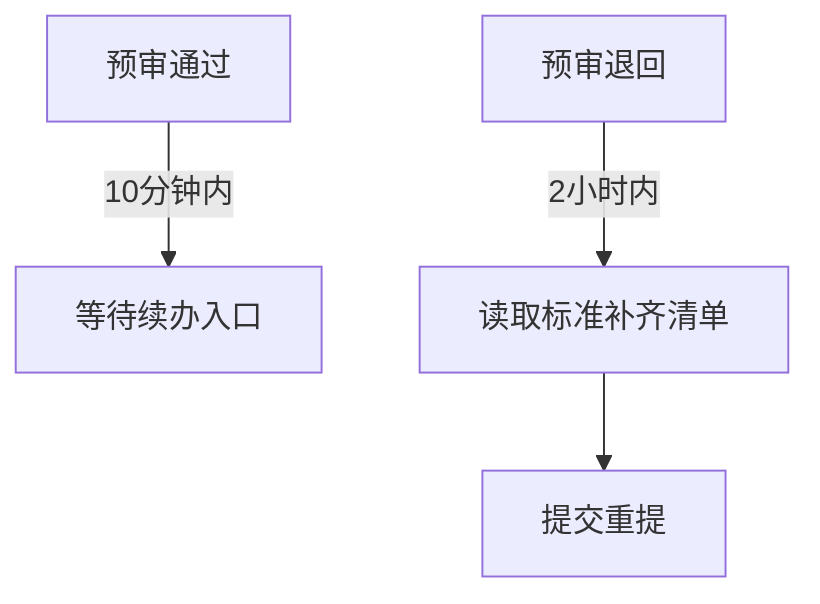
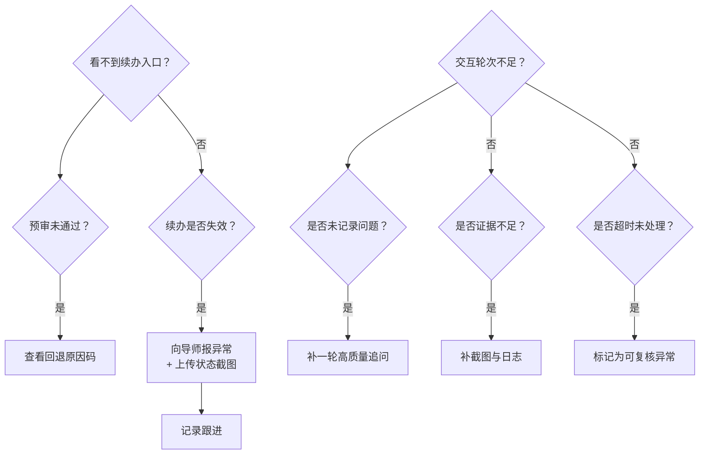

# 第三期专家入门与提交指引

> 版本：2026-07-24  
> 目标：新专家 10 分钟内完成首次提交闭环

## 0. 任务地图（第一次只做这一套）

## 1. 10 分钟入门流程（可照着执行）

### 1.1 认证与信息采集（第 1-2 分钟）
- 先确认你进入的是第三期专家路径  
- 按字段完整填写：姓名、豆包 UID、领域经验、项目背景、时间要求  
- 任意字段报错：先截图，再在群内报障，不要自己猜路径

### 1.2 预审提交（第 3-5 分钟）
- 一次性写清楚：
  - 背景  
  - 约束（权限、时间、边界）  
  - 验收标准（成功条件、失败条件）  
  - 是否存在敏感依赖  
- 注意：`预审通过` 只是进入交互门槛，不是通过验收

### 1.3 预审反馈处理（第 6-8 分钟）

### 1.4 交互执行（第 8-9 分钟）
- 统一在豆包办公任务内推进  
- 每轮必须有：问题、追问、下一步  
- 最低交互轮次：`6+`

### 1.5 结果回流（第 10 分钟后）
- 回流到导师：  
  1) 结论摘要  
  2) 证据截图（脱敏）  
  3) 时间戳  
  4) 风险说明（如果有）

## 2. 决策树（常见阻断）

## 3. 提交流程模板（15 分钟）

1. 题目背景：一句话说明场景与目标  
2. 约束条件：时间、权限、敏感边界  
3. 验收标准：可验证条件与反例  
4. 交互路径：追问、补充、对比  
5. 预期产出：结论、证据、风险

## 4. 规则红线（对内可直接转发）

- 不上传身份证/银行卡/验证码/密码  
- 不承诺任何非标准付款内容  
- 所有证据统一保存在任务系统（可复核）  

## 5. 异常工单文本（复制即用）

- `状态`：预审退回 / 续办未下发 / 交互停滞 / 结算拖延  
- `要素`：时间戳、问题摘要、截图、需求人、期望处理结果  
- `动作`：按固定清单补齐、标记优先级、确认升级人

## 5. 结算确认

- 结算标准：`200 元 / 题`  
- 启动条件：客户验收通过且结果回流完成  
- 目标时效：`3 个工作日内`
