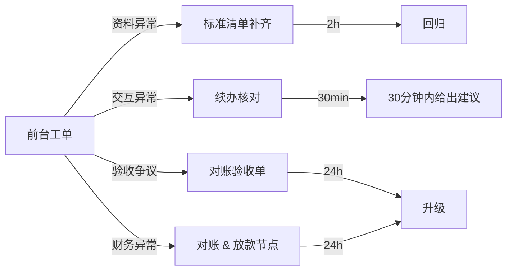
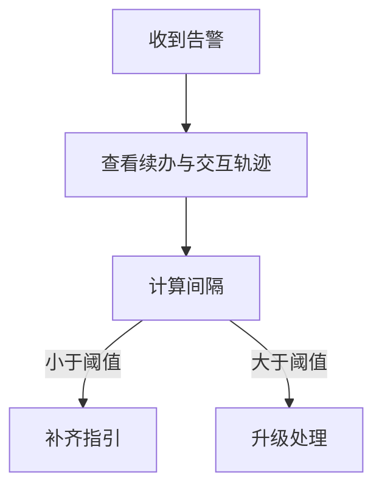

# 第三期运营异常处理 SOP

> 版本：2026-07-24  
> 目标：异常 30 分钟内可归因，24 小时内可升级闭环

## 0. 一张图先判断（异常优先级）



## 1. 固定处理法则（执行优先）

1. 一切以 Bitable 为准  
2. 先定性再定动作  
3. 每条异常都要记录：时间戳、处理人、证据、结果  
4. 到达阈值必须升级，不做重复一线兜圈

## 2. 一线分流标准

| 类型 | 一线动作 | 证据 | 升级条件 |
|---|---|---|---|
| 表单异常 | 引导用户重试并给字段映射 | 错误截图 + 时间戳 | 1 次重试仍失败 |
| 资料异常 | 下发补齐清单 | 缺口清单 + 版本号 | 24 小时仍未补齐 |
| 交互异常 | 查续办状态、轮次、轨迹 | 会话截图 + 轮次数 | 24 小时停滞或无效交互 |
| 客户验收异常 | 标记待处理，不替代结论 | 验收单 + 沟通记录 | 超过 24 小时无回复 |
| 结算异常 | 查财务状态和审批链 | 对账截图 + 金额与 ID | 24 小时未恢复 |

## 3. 处理模板（复制到工单）

### 3.1 表单/资料问题


### 3.2 交互停滞


### 3.3 结算迟滞


## 4. 异常升级树（默认规则）

```mermaid
flowchart TD
  上报[异常上报]
  上报 -->|超时类 (>24h)| 升级[运营联络人抄送财务/对接]
  上报 -->|证据类（缺证据）| 阻断
  阻断 --> 补证据
  上报 -->|规则冲突| 通知[通知导师组长和负责人定稿]
  补证据 --> 升级
```

## 5. 周周期治理（固定动作）

| 周期 | 检视项 | 目标 |
|---|---|---|
| 周一 | 异常 Top3 | 原因覆盖率 |
| 周二 | 交互复盘 | 返修率下降 |
| 周四 | 口径一致性 | 对外答疑一致 |
| 周五 | 财务对账 | 结算阻塞率下降 |

## 6. SLA 约束（必须达标）

- 预审判定：`15` 分钟  
- 续办推送：`10` 分钟  
- 异常分流：`30` 分钟  
- 结算异常处理：`3` 个工作日  

未达标不允许直接关闭，必须说明原因并升级处理人。

## 7. 版本规则（与 README 对齐）

- 本 SOP 为异常处理高优先级源  
- 子文档需保持与 README 同步版本  
- 变更先改主索引，再执行子文档补丁  
- 旧版本仅归档保留，不作外部执行依据
