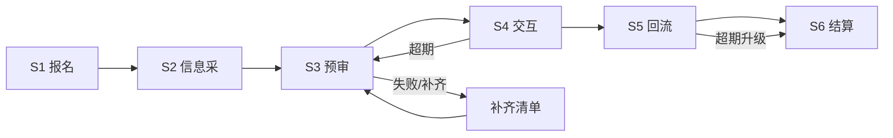
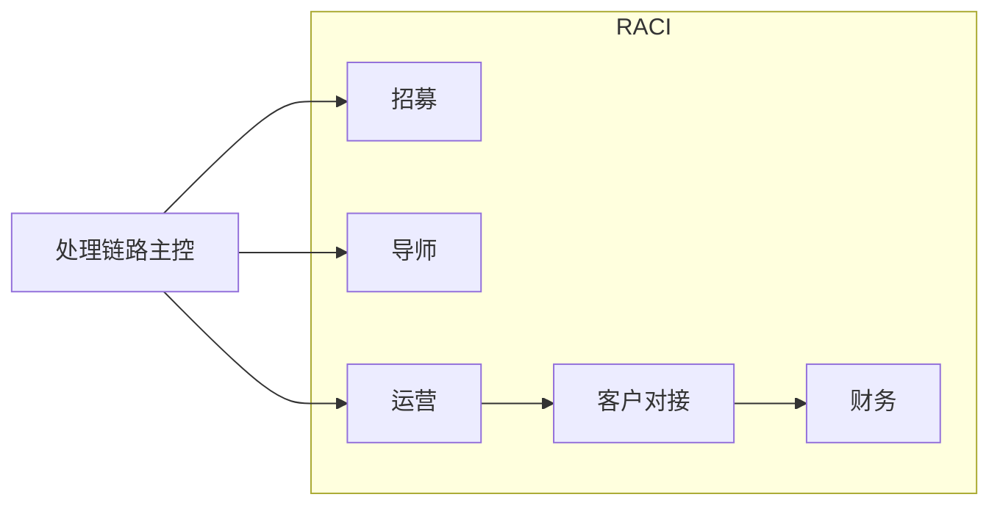
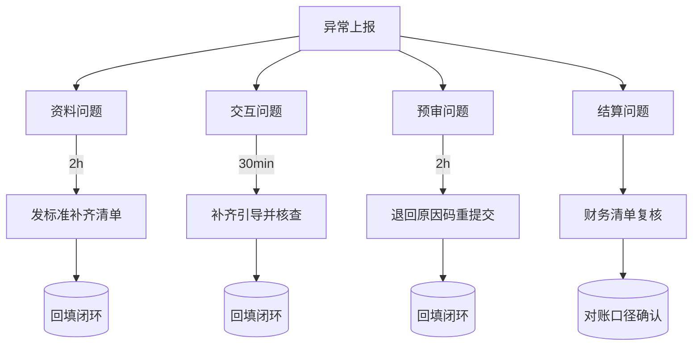

# 第三期专家运营包（对内）

> 版本：2026-07-24  
> 适用对象：招募、导师、运营、财务、对接  
> 统一真相：飞书 Bitable（Bitable 记录为法务边界内的唯一对账源）

### 一句话总纲
把“开题 → 预审 → 交互 → 回流 → 结算”做成一条可追踪闭环：  
**谁做、何时做、怎么升级、何时结清。**

---

## 0. 一图先读（主流程）

## 1. 分段工作目标（1 分钟读懂）

| 阶段 | 核心目标 | 产出 | 关键信号 |
|---|---|---|---|
| 报名 | 把需求接入系统并落地 | 报名记录、边界声明 | `待预审` |
| 预审 | 过滤不可交互内容，给出可行路径 | 预审结论、补齐项 | `可交互` / `补齐` |
| 交互 | 每题形成连续可追踪证据链 | 6+轮交互记录 | `结果待提交` |
| 回流 | 客观证据对齐客户与财务口径 | 结论、风险、时间戳 | `客户验收中` |
| 结算 | 按验收关闭财务链条 | 付款完成 | `已结算` |

---

## 2. 角色责任（RACI 可复制）

| 角色 | 负责人（R） | 审核（A） | 咨询（C） | 通知（I） |
|---|---|---|---|---|
| 招募同事 | 报名与资料完整性 | 招募主责人 | 导师/运营 | 系统负责人 |
| 导师 | 预审、续办、交互质量 | 导师组长 | 招募、运营、对接 | 全体相关 |
| 运营 | 异常分流与升级闭环 | 运营负责人 | 招募、导师、财务 | 客户对接 |
| 财务 | 结算/对账 | 财务负责人 | 运营 | 客户对接 |

---

## 3. 统一口径（不得偏离）

- 预审通过≠客户验收通过
- 结算触发 = 客户验收通过后且回流完成
- 结算时限 = 3 个工作日内
- 交互硬要求 = 6+ 轮
- 交互与资料提交必须走豆包办公任务，不得私域替代

---

## 4. 异常分流框（强制执行）

### 每个异常必填项
- 时间戳  
- 处理人  
- 处理动作  
- 证据（截图/日志/工单号）  
- 是否升级（是/否）  
- 归档证明（工单关闭时间）

---

## 5. 当日质量门禁（每天开工前）

- `待预审` 是否持续流转，是否卡死超时  
- 续办入口是否在 10 分钟内发出  
- 6+ 轮交互是否缺漏  
- 结算是否与验收单一致  
- 所有异常是否按时升级（超过阈值不允许悬挂）

---

## 6. 文档调用顺序（固定）

1. [01_RECRUITING_KIT.md](01_RECRUITING_KIT.md)：对外口径与对接话术  
2. [02_EXPERT_ONBOARDING.md](02_EXPERT_ONBOARDING.md)：新专家入门动作清单  
3. [03_OPERATOR_SOP.md](03_OPERATOR_SOP.md)：异常分流与升级操作

---

## 7. 发布与版本规则

- 本包变更只允许：主文档先行修订 → 子文档再同步更新  
- 同步失败不允许出现新口径（如有冲突，以主文档为准）  
- 旧版本仅用于追溯，不可再对外引用
