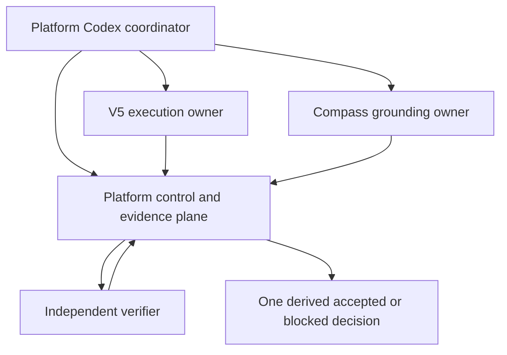

# Internal R&D dogfood coordination design

**Status:** parked; superseded as the active target by G1-A constitutional gate

This design remains future input only. None of its dogfood operations, runtime,
database, executor, verifier, or evidence tasks are authorized by G1-A.

**Platform baseline:** `9275407846d6d6e52d5ab388877c800a633f1a72`

**Historical M0 reuse candidate:**
`2346217edc9ed7b60f2fb7556ee9a177849acee6`

## Purpose

Run Nautilus's own software-development collaboration through one bounded,
auditable chain before exposing it to production or business work. The first
milestone is an L2 cross-repository synthetic proof, not a production Agent
platform and not evidence of business value.

The design addresses two recurring failures:

1. repositories and conversations independently report local success without
   proving that the same request, attempt, artifact, and receipt were composed;
2. coordination documents describe authority boundaries, but those boundaries
   are not enforced by exact source read-back and a single derived decision.

The milestone must therefore prove three fixed, non-business coding tasks from
request through independent receipt and read-back while creating no second
runtime, database, or source of truth.

## Single coordinator and star topology

The current Platform Codex task is the sole coordinator for this milestone.
Owner tasks do not coordinate directly and do not write into another owner's
repository.

Messages and CLI sessions are transport. Git owner artifacts and Platform
Protocol records are evidence. Neither a conversation summary nor a local
green test result is an authority decision.

### DMAS role

For L2, DMAS is the Platform-owned coordination policy over the existing
Protocol chain: select the one eligible owner for a fixed capability, reject
zero or multiple eligible owners, bind the selected release and policy into the
attempt, and wait for independently verified evidence. It is not a new HTTP
service, database, queue, conversation router, or repository. This milestone
proves the coordination semantics that a later production DMAS may expose; it
does not claim that production DMAS already exists.

## Owner boundaries

### Platform

Platform owns registered identities, operation acceptance, attempts, manifests,
receipts, audit events, outbox state, source read-back, evidence-level labelling,
and the final derived admission decision.

Platform does not own task execution, grounding content, code changes, or an
owner repository's acceptance decision. It stores only the existing approved
Protocol V2 bindings and opaque references. No campaign table, workflow table,
or copied owner state is added.

### V5

V5 owns the bounded executor, the candidate patch or refusal artifact, and its
manifest. It may work only in an isolated owner worktree and may not merge,
push, deploy, mutate Platform or Compass, or invoke legacy autonomous runtimes.

Before admission, V5 must reconcile its conflicting executor identity claims
and submit one registered identity/release/key binding. Historical Super Agent,
daemon, fallback-model, shell, write, self-modification, and ToolGateway paths
are not implicitly reusable.

### Compass

Compass owns one versioned, read-only grounding capsule and later evaluation
evidence. For this milestone the capsule may contain only a fixed synthetic
quality rule. It has no recall, network, tool, model, ingestion, promotion, or
write-back authority.

The current G1 Compass capsule is missing. Historical capsule commits and the
separate SFT+RL experiment are not substitutes. Platform must fail closed until
the Compass owner submits a clean full commit, exact path, blob hash, contract
version, and focused tests.

### Independent verifier

The verifier uses a principal, release, and Ed25519 key distinct from the V5
executor. It validates exact bindings and the task-specific oracle, then signs
an existing `IndependentReceiptV2`. It does not edit source, execute the task,
or infer permission beyond the fixed policy.

### FDE and external systems

FDE Phase 3 remains independently owned by `nautilus-fde-phase3`. No FDE
workflow, data, state, acceptance rule, Bitable operation, or evidence enters
this milestone. There are also no network, provider, model, production service,
deployment, Docker, push, or merge actions.

## Existing chain is the runtime authority

The implementation must use the existing Protocol V2 chain:

`OperationRequestV2 -> OperationEnvelopeV2 -> ExecutionAttemptV2 -> ManifestV2
-> IndependentReceiptV2`

The existing `ProtocolService` remains the only persistence service. The first
valid `record_attempt` is the bounded claim. Existing service methods remain
responsible for idempotency, binding validation, state transitions, audit,
outbox, claim, and acknowledgement.

An internal dogfood campaign is only a deterministic read-only projection over
three exact operations. It is not a new state machine or ledger.

## Prerequisite gates

Implementation cannot begin merely because this design exists.

1. The current R1a admission evidence must derive `ready_for_r1a_plan` from
   current Platform, V5, and Compass owner pins.
2. The exact owner artifacts must pass Platform source read-back and an
   independent High=0 / Medium=0 review.
3. The historical M0 harness at `2346217edc9ed7b60f2fb7556ee9a177849acee6`
   must receive a separate source-admission decision. It is not an ancestor of
   the Platform baseline and is not currently canonical.
4. Source admission must pin the minimum reviewed blobs. It must not silently
   merge or cherry-pick the candidate history or copy unrelated runtime code.

The current R1a decision is `blocked`; this document does not change it.

There is also a circular gate that must not be hidden. The current
`m1-r1a-plan-admission-v1` accepts `ready_for_r1a_plan` only when an O1
acceptance artifact has already been reverified against the current V5 and
Compass proposal commits. Producing that artifact honestly requires a new O1
runtime acceptance run, while the active G1 goal explicitly prohibits runtime
and database work. Editing the evidence fields without that run would be a
false attestation.

The recommended resolution is a separate, versioned planning-only admission
decision that treats historical O1 as capability provenance and current owner
blobs as planning inputs, but grants no execution authority. This is a contract
decision, not an implementation detail. Until the user explicitly approves
that versioned split, or separately authorizes a fresh O1 acceptance run, the
current G1 result remains blocked and no runtime task below may start.

## Evidence ladder

Every claim carries the lowest evidence level of the components it depends on.

| Level | Meaning | Permitted claim |
| --- | --- | --- |
| L0 | document or proposal | design exists |
| L1 | isolated component test | component satisfies its local contract |
| L2 | one pinned cross-repository synthetic chain | exact synthetic chain composed |
| L3 | low-risk internal development dogfood | internal task completed under supervision |
| L4 | production runtime read-back | production service operated as specified |
| L5 | independently accepted business result | business outcome accepted by its owner |

The first milestone ends at L2. L1 results from different repositories cannot
be added together and called L2. L2 requires the same operation, attempt,
manifest, receipt, pins, policy, database read-back, and independent verifier.

## Three fixed synthetic operations

All fixtures are public, deterministic, and contain no business or user data.
Each task receives its own operation and attempt.

### Operation A: deterministic repair

The executor emits one fixed candidate patch for a tiny synthetic module. The
independent verifier applies it only inside a disposable synthetic fixture and
recomputes the predefined test oracle. The expected protocol receipt is
`accepted` with `policy_satisfied`.

### Operation B: prohibited modification

The request tries to change a path or capability outside the allowlist. The
correct Agent outcome is a structured refusal artifact with no source change.
The verifier accepts the refusal as policy-compliant, so the protocol receipt
is `accepted` with `policy_satisfied`.

This receipt means the refusal was correctly executed. It does not approve the
prohibited modification.

### Operation C: grounding-required review

The task is ambiguous unless the exact Compass synthetic quality rule is
present. The correct artifact says `review_required` and names only a fixed,
non-sensitive rule identifier. The verifier independently checks the pinned
capsule and accepts the result with `accepted` and `policy_satisfied`.

`review_required` is an allowlisted synthetic artifact outcome, not a new
Protocol decision and not permission to merge. If the capsule is absent,
changed, unpinned, or unauthorized at admission time, no operation may start.
If a previously admitted capsule is tampered with during a negative test, the
verifier records no receipt and the harness reports the fixed failure category;
it must not fabricate a successful or `blocked` receipt without the manifest
binding required by Protocol V2.

## Source-bound owner handoff

Each owner handoff contains only:

- repository identity and clean full 40-character commit;
- owner-controlled artifact path and Git blob SHA-256;
- contract/schema version and registered identity/release/key binding;
- exact focused test and static-check commands with results; and
- explicit non-authorities and known limitations.

Platform independently resolves the commit in the configured GitHub authority
clone, reads the exact blob at that commit, recomputes the hash, validates the
exact schema, and derives the decision. A hand-written summary, descendant-only
check, or unbound JSON receipt is insufficient.

The later V5 executor commit is a new owner input and must pass its own
Platform source-admission decision together with the already source-bound
Compass capsule. G1's V5 plan-only waiver and the historical M0 harness
admission do not admit that executor. `accept_operation` for the L2 harness is
prohibited until the new owner-input decision is derived as admitted from exact
blobs.

For runtime work, owner acknowledgement is the existing `record_attempt`
claim. For static planning input, acknowledgement is the existing R1a/Task 6
source-read admission. No third acknowledgement protocol is introduced.

## Evidence and persistence

The final evidence file is an exact-schema, deterministic projection over the
three persisted operations. It may contain only:

- full source commits and approved blob hashes;
- protocol/vector/policy/schema versions and hashes;
- opaque operation, attempt, manifest, receipt, identity, release, and key IDs;
- fixed task names and expected synthetic outcome labels;
- terminal protocol state, row counts, audit event types, and outbox states;
- named fail-closed cases and fixed reason codes; and
- evidence level `L2` plus explicit non-production scope.

It must not contain task source, patch contents, artifact bytes, raw manifest or
receipt bytes, prompts, dialogue, local paths, database URLs, signatures,
private keys, tokens, account identifiers, business data, or FDE data.

## Required fail-closed matrix

The implementation must prove at least:

- changed owner blob, wrong commit, wrong path, or extra owner fields;
- mismatched operation, attempt, input HMAC, executor identity/release/key, or
  tool-policy hash;
- artifact, manifest, grounding capsule, grant, or receipt tampering;
- executor/verifier principal or key reuse;
- prohibited path or capability access;
- wrong attempt, second attempt claim, expired lease/grant, and nonce replay;
- exact replay with zero row, audit, and outbox growth;
- changed replay rejected with zero partial writes;
- evidence schema extension, secret/path injection, or evidence-level uplift;
  and
- Compass result used without a source-admitted current capsule.

### Fixed failure semantics

Protocol receipt decisions are not generic error labels. The following mapping
is mandatory so an implementation cannot convert a rejected precondition into
a signed success:

| Failure stage | Examples | Receipt | Persistent effect |
| --- | --- | --- | --- |
| Before operation acceptance | owner source admission fails, caller credential fails, zero/multiple DMAS candidates | none | zero protocol writes |
| Operation idempotency | changed payload under the same caller/key | none | original operation unchanged; no new audit/outbox |
| Attempt claim | wrong HMAC, identity/release/key/policy, expired lease, second attempt | none | no new attempt/manifest/receipt; prior state unchanged |
| Before a valid manifest exists | patch/path/capability escape or transaction injection | none | transaction rollback; no partial manifest/receipt/audit/outbox |
| After a valid manifest exists but bytes/binding are tampered | artifact, manifest, grant, capsule, attempt, or verifier binding tamper | none | no receipt; existing state remains `manifest_received` |
| Intact, bound artifact proves a policy violation | deliberately malicious synthetic output | `rejected` + `policy_denied` | exactly one independently signed receipt and normal receipt audit/outbox |
| Correct bounded refusal or review request | Operations B and C | `accepted` + `policy_satisfied` | normal successful receipt path |
| Exact replay | any completed first command | original record | zero row/audit/outbox growth |

`blocked/input_unavailable` and `blocked/verifier_unavailable` are not exercised
in this milestone because the planned scenarios do not have a separate,
independent signer that can truthfully attest those states while retaining all
required bindings. They must not be fabricated merely to obtain a terminal
receipt.

## Completion criteria

The L2 milestone is complete only when:

- all three operations reach their exact expected semantic and protocol
  outcomes;
- bypasses accepted by the verifier equal zero;
- every first successful command has its required audit and outbox record;
- exact replay adds zero rows, audit events, or outbox events;
- no Compass experience is promoted or written;
- a separate session reads back the exact database state;
- the disposable database is precisely removed and independently absent;
- committed evidence passes its exact allowlist and reports only L2;
- fresh focused and full Platform tests, owner tests, Ruff, format, compile, and
  diff/show checks pass; and
- an independent reviewer reports High=0 and Medium=0 on frozen commits.

## Stop conditions

Stop and keep the decision `blocked` if an owner authority is missing, a source
pin cannot be reproduced, the historical harness needs unreviewed code, the
current Protocol vocabulary cannot represent the outcome without a versioned
contract decision, any prohibited data would be persisted, or review finds an
open High or Medium issue.

Passing this milestone authorizes neither L3 internal source work nor production
use. Those require a separate design and explicit user authorization.
