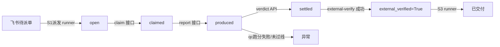

# FDE 三期工作流 SOP（团队执行版）

版本: 2026-07-24  
适用范围: `phase3/backend` 与飞书多维表格三期链路（S1 派活 + S2 交互 + S3 交付）

## 一、目标与边界

目标不是“能看见任务”，而是完成一件任务的闭环：

- 派单（S1）→ 领取/生成（S2）→ QC 反馈（S2）→ verdict 记录（平台）→ 外部验收（S3）→ 交付与结算（S3）。

边界原则:

- 出题表和交互表逻辑上分离，数据上同一任务用 `task_uid` 绑定。
- 任何一项自动化动作都应以平台真值为准，不以“自报口径”判断完成。
- 只有后端接口写入的 `verdict` 与 `external-verify` 才能驱动闭环落盘。

## 二、角色与责任

### 1. 运营/调度（S1）

- 在飞书派活表新增一行待派单任务，至少补齐:
  - `task_uid`
  - `标题`
  - `业务线`
  - `验收标准`
  - `指派专家` 或 `expert_id/open_id`（推荐 `open_id`）
- 任务行需保持 `状态=待派单`。
- 监控派发失败/异常行，重试前先确认字段是否齐全。

### 2. 生产执行（S2，专家）

- 只处理 S2 阶段任务内容，不改动派活元数据。
- 接受并认领后，完成交付稿件写到 `提交内容`，并将行状态改为 `已提交`。
- 非空、可读、可追溯的正文才算有效提交。

### 3. QC

- 仅对 `已提交` 行做内容打分与反馈，不重写正文。
- 输出反馈写入 `QC反馈`，并同步 S2 状态:
  - 通过: `已通过`
  - 不通过: `已打回` 并返回具体修改项。
- 通过行由平台 verdict 自动推进到后续判定，前端与表单只做结果回写。

### 4. 平台/运维

- 维护 3 个常驻自动任务（只配置一次并长期保留）：
  - S1: 每 5 分钟（派发）
  - S2: 每 5 分钟（QC）
  - S3: 每 10 分钟（交付/结算）
- 负责异常回收与外部验收推进：
  - 外部验收触发接口 `PATCH /api/platform/fde/verdict/{verdict_id}/external-verify`
- 持续监控 `GET /api/platform/fde/tasks` 与 `GET /api/platform/fde/my-status`。

## 三、状态闭环（建议抄写在运营看板）

### 平台主状态与表单状态映射（便于例会汇报）

- 平台状态:
  - `open`（待领取）
  - `claimed`（已领取）
  - `produced`（已回报）
  - `settled`（有 verdict，完成核心闭环）
  - `abandoned`（长时间卡住后入死信）
- 飞书状态:
  - S1: `待派单`、`已派单`、`异常`
  - S2: `已提交`、`已通过`、`已打回`
  - S3: `已通过`、`已交付`

## 四、执行节拍（建议）

### 每 15 分钟检查（调度员）

- `GET /api/platform/fde/tasks?status=open`：待分配是否堆积。
- `GET /api/platform/fde/tasks?status=produced`：是否有待判卡住过久任务。
- `GET /api/platform/fde/tasks?status=settled`：是否有最新交付可同步到结算。

### 每日闭环复盘

1. 当日 `produced` 变 `settled` 的比例。
2. `QC反馈` 打回率和反复打回比例。
3. `external-verify` 成功率与被拒原因分桶。
4. 结算表 `应付状态` 与 `payable_amount` 是否齐备。

## 五、故障处理（优先级）

1. `待派单`行长时间不变  
   - 先检查 `验收标准` 非空、`task_uid` 非空、专家身份字段是否有值。  
   - 检查 S1 常驻任务是否在正常执行；确认最近一次自动扫描有无异常；并确认 `已派单/异常` 写回正确。
2. `已提交`无反馈  
   - 检查 `提交内容` 空值或行状态是否误改。  
   - 确认 QC runner 是否在正常轮询。
3. `已通过`但未写入交付  
   - 检查 verdict 是否存在且 `overall_pass=True`。  
   - 检查交付 runner 能否读取 `verdict-bus` 与交付表权限。
4. `external-verify` 多次失败  
   - 检查 `verifier_source` 与 `verdict.source` 是否不同。  
   - 检查 `external_verified` 是否重复触发幂等回路。

## 六、关键接口（固定引用）

- 派单: `POST /api/platform/fde/dispatch`（admin key）
- 领取: `POST /api/platform/fde/claim`
- 回报: `POST /api/platform/fde/report`
- 任务列表: `GET /api/platform/fde/tasks`
- verdict 上报: `POST /api/platform/fde/verdict`
- 外部验收: `PATCH /api/platform/fde/verdict/{verdict_id}/external-verify`
- 个人状态镜像: `GET /api/platform/fde/my-status`
- 历史 verdict 查询: `GET /api/platform/fde/verdict/{task_uid}`

## 七、外部专家与团队上手（FDE）

- 团队上手路径（推荐）：
  - 飞书作为一线作业面：按字段规范补齐 S1（出题）和 S2（交互）表单并保持 `task_uid` 一致。
  - 网站作为人机协同总控：`https://www.nautilus.social/docs/fde-phase3`，每天按 10 分钟巡检。
  - Ops 先看网站“人机协同待办（attention）”，把 pending 全部处理成决议后再执行下一轮 runner。

- 外部专家接入要点（不用理解全系统）：
  - 只看 S2：收到 `任务 UID` 与 `提交内容` 后写稿，并将状态改为 `已提交`。
  - 只要正文非空、可读、可追溯就会进入 QC；QC 通过后才有 closed-loop 的下一步。
  - 被打回后按 `QC反馈` 修改后再改回 `已提交`。

- 外部专家 UID 自动化（系统已按优先级执行）：
  - 取值顺序：`expert_id` -> `open_id` -> `assignee`。
  - 后端会把该顺序用于 claim / report / delivery，减少“字段缺失导致黑盒等待”。
  - 建议运维侧只保留 `expert_id` 字段的主来源，`assignee` 作为兼容兜底。

- 站点发布建议：
  - 子域接入：`fde.nautilus.social` 指向同站点前端发布目录。
  - 建议每次发布后执行：
    - `curl -I https://www.nautilus.social/docs/fde-phase3`
    - `curl -I https://fde.nautilus.social/docs/fde-phase3`

## 八、文档与证据

- 业务口径锚: `FDE_BUSINESS_CHARTER.md`、`LOOP_STATE_SSOT.md`
- 运行日志与探针优先级: 以接口响应与数据库读数为准
- 若字段命名或表格迁移，请先更新 `FDE_BUSINESS_CHARTER.md` 与团队操作手册。

## 九、5 分钟联调清单（单样本）

- 目标：一单在 25 分钟内完成 S1→S2→S3 核心闭环。
- 执行者：运营 1 人 + 专家 1 人 + QC 1 人 + 运维 1 人（可轮换）。

1. 新建 S1（00:00）
   - 填 `task_uid`、标题、业务线、验收标准、专家身份（`expert_id/open_id` 之一）。
   - 状态改 `待派单`。
   - 15 分钟内观察：`open` 任务条目应被 S1 变更为 `已派单`，或在异常列 `异常` 并给出 reason。

2. S2 提交（05:00 后）
   - 专家在同一 `task_uid` 下填写提交内容，状态改 `已提交`。
   - 若字段未写，S2 阶段会停留，不应手工触发 runner。
   - 10 分钟内观察：S2 应回写 `QC反馈` 且状态进入 `已通过/已打回`。

3. 外部验收与入账（10~20:00）
   - 对于 `已通过` 行，核对 verdict 存在且 `overall_pass=True`。
   - 执行 external-verify 后，观察 S3 对交付/结算表的写入。
   - 至少出现一次 `pending attention` 处理并决议，流程应继续前进。

4. 关闭判断（20~25:00）
   - 若 `deliver` 与 `settle` 可见、状态到达最终态，认定闭环成功。
   - 记录异常项和字段缺失原因，回到第 5 条故障树。

## 十、失败回滚树（处理优先级）

- A. S1 长期不变（>10 分钟）
  - A1 检查 `task_uid` 是否重复/空：重复改为新 uid 重建，空的补齐后重试。
  - A2 检查验收标准是否空：空则回填后恢复待派单，等待下一轮 S1。
  - A3 仍未推进：检查 `task_uid` 是否写入平台端与飞书一致、S1 常驻任务日志是否报错。

- B. S2 长期不变（>15 分钟）
  - B1 专家未提交：提示专家补齐提交内容。
  - B2 提交后无 QC 回写：检查状态是否为 `已提交`、是否被误改为其他状态。
  - B3 有提交但无反馈：核实 S2 常驻任务是否在执行并无异常。

- C. 已通过未交付
  - C1 核对 verdict：`overall_pass=False` 不应入账。
  - C2 检查外部验收是否完成：未验收不应进入最终态。
  - C3 权限/表结构缺失：确认交付表、结算表可写。

- D. 外部验收失败
  - D1 记录 verifier_source 与判分来源冲突。
  - D2 按策略回退为重提，任务状态退回 `待派单` 或 `已提交` 分支由人确认。
  - D3 修复后再走标准流程，不在同一样本中循环复测超过 2 次。
